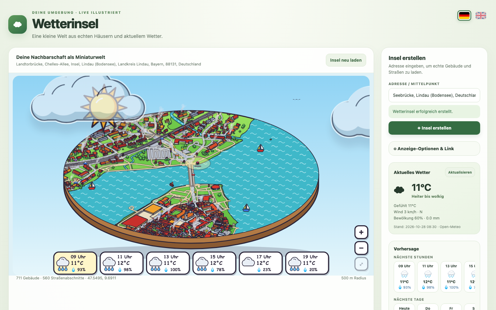

# Wetterinsel · Weather Island

[English](README.md) · **Deutsch**


Adresse eingeben und die Umgebung als kleine **isometrische Comic-Insel** sehen: echte Gebäude, Straßen, Gleise, Bäche, Seen und Parks aus OpenStreetMap, zum Leben erweckt durch das **aktuelle Wetter** von Open-Meteo – ziehende Wolken, Regen, Schnee, Wind, Tag und Nacht, sogar die Mondphase.

Die Wetterinsel läuft als selbst gehostete **Docker**-App oder als **einzelne HTML-Datei**, die du auf jeden Webserver legst – und sie hat einen minimalen **Kiosk-Modus**, um sie als iFrame in Dashboards (z. B. Home Assistant) einzubetten.

**Live-Demo:** https://haydecker.github.io/wetterinsel/ (Einzeldatei-Version; nutzt direkt die öffentlichen Kartenserver, das erste Laden eines Ortes kann dauern)

> Stand: Hobbyprojekt, Version 1.1. Öffentliche Karten- und Wetterdienste sind Gemeinschaftsressourcen – bitte vor dem Betrieb einer öffentlichen Instanz [RECHTLICHES.md](docs/RECHTLICHES.md) lesen.

## Highlights
- Echte Kartendaten: Gebäude, Straßen, Wege, Gleise mit kleinem Zug, Bäche, Teiche, **Seen** (z. B. Bodensee mit Segelbooten), Parks, Äcker, Spielplätze, Hecken, Stromleitungen, Haltestellen
- Live-Wetter: Sonne, Wolken, die sich mit echter Windrichtung und -stärke bewegen, Regen, Nieselregen, Schnee, Nebel, Gewitter, Vögel, Rauch aus Schornsteinen bei Kälte
- Die ganze Scheibe per Ziehen (Maus oder Finger) drehen, wenn der Kompass an ist
- Tag, Dämmerung und Nacht nach echtem Sonnenauf-/-untergang; Mondphase; optionaler Kompass
- Vorhersage (Stunden oder Tage) im Bild oder in der Seitenleiste
- Zoom, Verschieben und Touch für Smartphone und Tablet; als Web-App installierbar
- Kiosk-Modus und URL-Parameter zum sauberen Einbetten – siehe [docs/FEATURES.de.md](docs/FEATURES.de.md)
- **Zweisprachig: Deutsch und Englisch** – per Klick auf die Flaggen oben umschaltbar (oder `sprache=en`); die Wahl wird gemerkt



## Zwei Arten, sie zu betreiben

### 1. Docker (mit Server-Cache)
```bash
git clone https://github.com/Haydecker/wetterinsel.git
cd wetterinsel
docker compose up -d --build
```
Öffnen: `http://localhost:8088`. Der eingebaute Node-Server liefert die App aus, **speichert Kartendaten und Adresssuchen dauerhaft** (`./data`) und wiederholt Abfragen, wenn die öffentlichen Overpass-Server überlastet sind. Trage in `docker-compose.yml` deinen eigenen Kontakt ein (`CONTACT`) – Nominatim und Overpass erwarten einen identifizierbaren User-Agent.

### 2. Einzeldatei (ohne Backend)
[`html/wetterinsel.html`](html/wetterinsel.html) herunterladen (ca. 130 KB, alles eingebettet) und auf einen beliebigen statischen Webserver legen. Sie spricht direkt aus dem Browser mit Nominatim, Overpass und Open-Meteo und merkt sich Karten 7 Tage im Browser. Das erste Laden eines neuen Ortes kann dauern, wenn die öffentlichen Overpass-Server ausgelastet sind.

Selbst bauen: `npm install && npm run build:single` → `dist-single/index.html`.

## Einbetten / Kiosk-Beispiel
```html
<iframe src="https://dein-host/?adresse=Marienplatz%2C%20M%C3%BCnchen&kiosk=true&wetter=true&radius=300"
        width="800" height="600" style="border:0"></iframe>
```

## Entwicklung
```bash
npm install
npm run dev            # Vite-Entwicklungsserver (ohne Server-Cache, direkter Overpass-Zugriff)
npm run build          # Typprüfung + Produktions-Build (dist/)
npm run build:single   # Einzeldatei-Build (dist-single/index.html)
```
TypeScript (strict), Vite, SVG-Rendering, keine Laufzeit-Abhängigkeiten. Der Server (`server.mjs`) nutzt nur Node.js-Bordmittel.

## Daten & Quellen
Kartendaten © [OpenStreetMap-Mitwirkende](https://www.openstreetmap.org/copyright) (ODbL) · Wetter von [Open-Meteo](https://open-meteo.com/) (CC BY 4.0, nicht kommerzielle Nutzung) · Adresssuche über Nominatim. Siehe [NOTICE](NOTICE) und [docs/RECHTLICHES.md](docs/RECHTLICHES.md).

## Lizenz
[Apache License 2.0](LICENSE). Daten Dritter unterliegen eigenen Bedingungen (siehe oben). Die Darstellung ist eine stilisierte Miniatur, kein maßstabsgetreues Modell; Wetter- und Kartendaten werden ohne Gewähr bereitgestellt.
