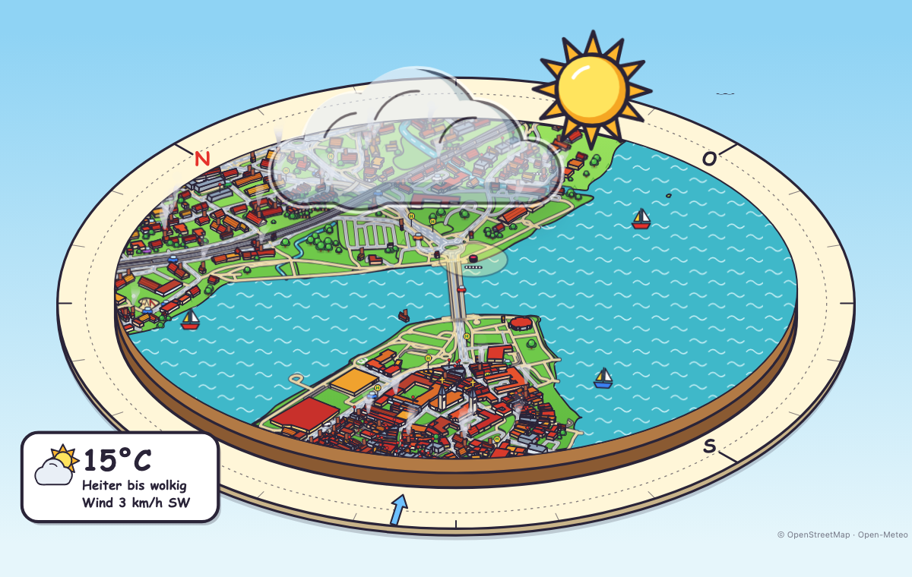
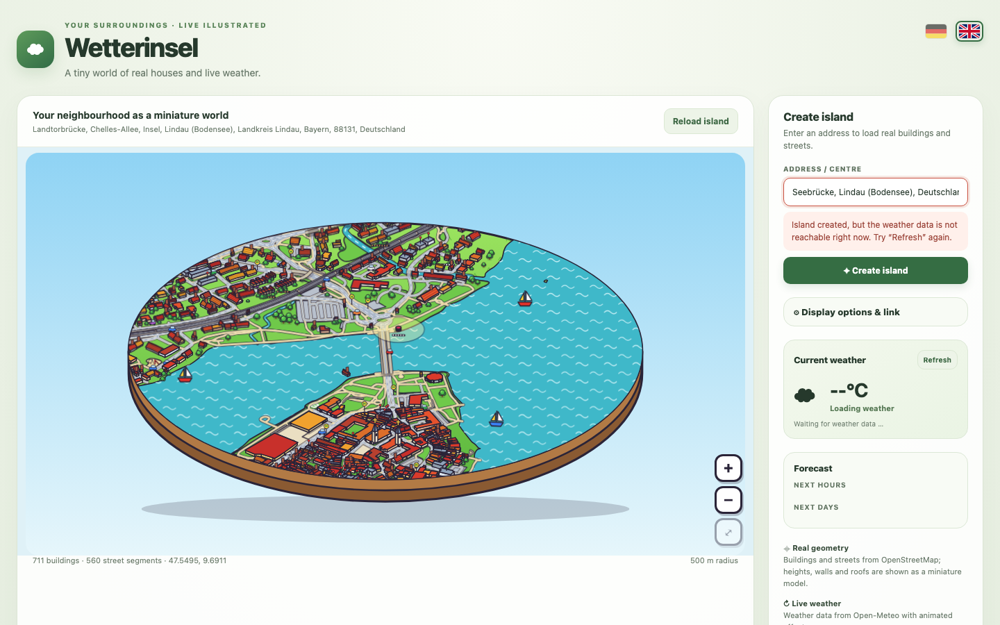

# Wetterinsel · Weather Island

**English** · [Deutsch](README.de.md)



Type in an address and get your surroundings as a small **comic-style isometric island**: real buildings, streets, rails, streams, lakes and parks from OpenStreetMap, brought to life by the **current weather** from Open-Meteo – drifting clouds, rain, snow, wind, day and night, even the moon phase.

It runs as a self-hosted **Docker** app or as a **single HTML file** you can drop on any web server – and it has a minimal **kiosk mode** to embed it as an iFrame in dashboards (e.g. Home Assistant).

**Live demo:** https://haydecker.github.io/wetterinsel/ (single-file version; uses the public map servers directly, so the first load of a place can take a while)

> Status: hobby project, version 1.1. Public map and weather services are shared resources – please read [LEGAL.md](docs/LEGAL.md) before running a public instance.

## Highlights
- Real map data: buildings, roads, paths, rails with a little train, streams, ponds, **lakes** (e.g. Lake Constance with sailing boats), parks, fields, playgrounds, hedges, power lines, bus stops
- Live weather: sun, clouds moving with the real wind direction and speed, rain, drizzle, snow, fog, thunderstorm, birds, smoke from chimneys when it's cold
- Rotate the whole disc by dragging it (mouse or finger) when the compass is on
- Day, dusk and night from real sunrise/sunset; moon phase; optional compass
- Forecast (hours or days) in the picture or side panel
- Zoom, pan and touch for phones and tablets; installable as a web app
- Kiosk mode and URL parameters for clean embedding – see [docs/FEATURES.md](docs/FEATURES.md)
- **Bilingual: German and English** – switch with one click on the flags in the header (or `sprache=en`); the choice is remembered



## Two ways to run it

### 1. Docker (with server-side cache)
```bash
git clone https://github.com/Haydecker/wetterinsel.git
cd wetterinsel
docker compose up -d --build
```
Open `http://localhost:8088`. The built-in Node server serves the app, **caches map data and geocoding results** on disk (`./data`) and retries when the public Overpass servers are busy. Set your own contact in `docker-compose.yml` (`CONTACT`) – Nominatim and Overpass ask for an identifiable User-Agent.

### 2. Single HTML file (no backend)
Download [`html/wetterinsel.html`](html/wetterinsel.html) (≈130 KB, everything inlined) and put it on any static web server or open it from a web server of your choice. It talks directly from the browser to Nominatim, Overpass and Open-Meteo and caches maps in the browser for 7 days. The first load of a new place can take a while when the public Overpass servers are busy.

Rebuild it yourself: `npm install && npm run build:single` → `dist-single/index.html`.

## Embed / kiosk example
```html
<iframe src="https://your-host/?adresse=Marienplatz%2C%20M%C3%BCnchen&kiosk=true&wetter=true&radius=300"
        width="800" height="600" style="border:0"></iframe>
```

## Development
```bash
npm install
npm run dev            # Vite dev server (no server-side cache; direct Overpass access)
npm run build          # type-check + production build (dist/)
npm run build:single   # single-file build (dist-single/index.html)
```
TypeScript (strict), Vite, SVG rendering, no runtime dependencies. The server (`server.mjs`) only uses Node.js built-ins.

## Data & attribution
Map data © [OpenStreetMap contributors](https://www.openstreetmap.org/copyright) (ODbL) · Weather by [Open-Meteo](https://open-meteo.com/) (CC BY 4.0, non-commercial use) · Geocoding by Nominatim. See [NOTICE](NOTICE) and [docs/LEGAL.md](docs/LEGAL.md).

## License
[Apache License 2.0](LICENSE). Third-party data is under its own terms (see above). The illustration is a stylised miniature, not a true-to-scale model; weather and map data come without warranty.
